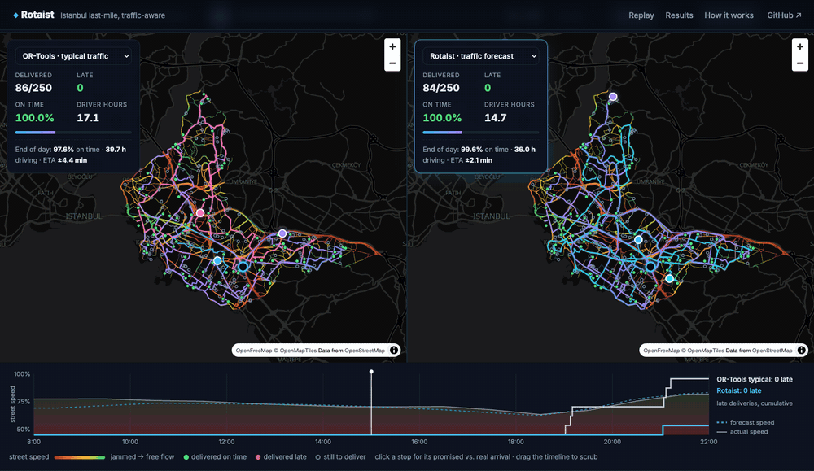
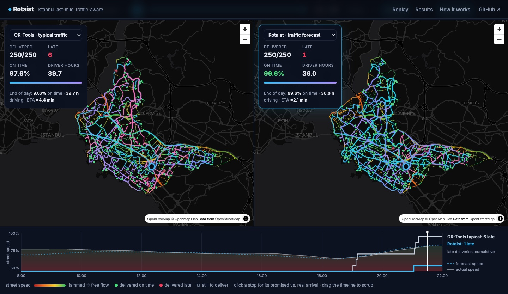
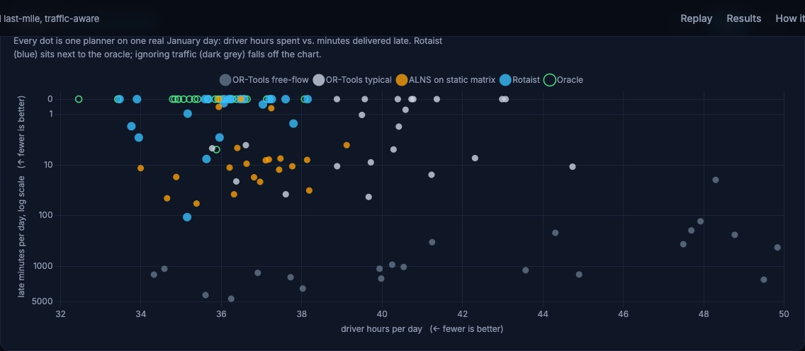
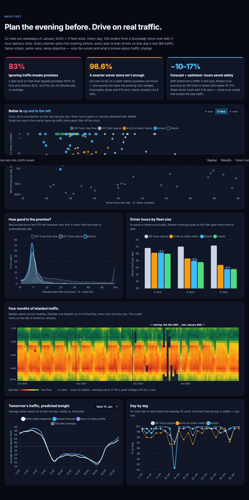
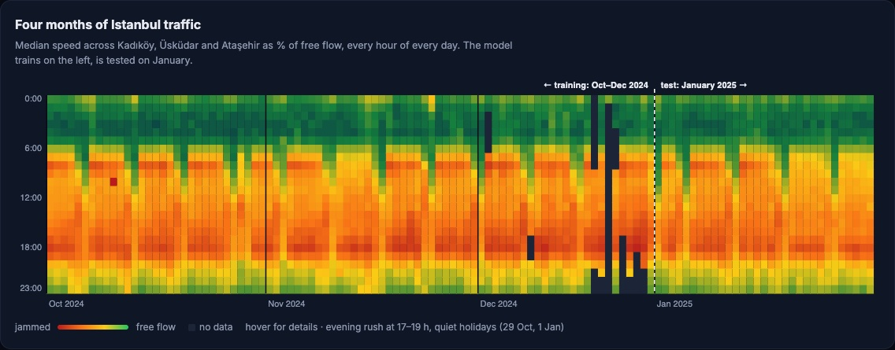
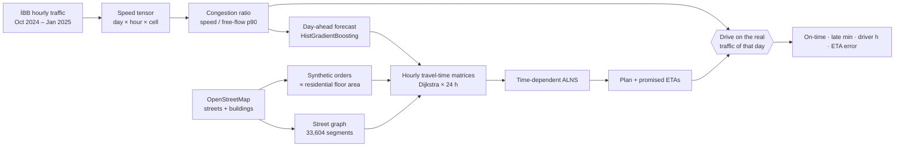

<div align="center">

# ◆ Rotaist

**Traffic-aware last-mile delivery planning for Istanbul.**
Forecast tomorrow's traffic from İBB open data, plan vans on hour-by-hour travel times with a home-grown
ALNS optimiser, and check every plan against the traffic that really happened.

[](https://github.com/emrtunali/rotaist/actions/workflows/ci.yml)
[](https://emrtunali.github.io/rotaist/)


[**▶ Open the live replay**](https://emrtunali.github.io/rotaist/) · [Results](results/RESULTS.md) · [How it works](#how-it-works)



<sub>Wed 29 January 2025, 15:00 → 22:00, the same 250 orders. Left: OR-Tools planned on typical traffic. Right: Rotaist.
Streets are coloured by the congestion İBB actually recorded that hour, and the timeline counts late deliveries.</sub>

</div>

---

## The problem

In Istanbul the same 3 km can take 8 minutes at 06:00 and 20 minutes at 18:00. Most route planners
still optimise on **one travel-time matrix for the whole day**, either free-flow speeds or a daily
average. The plan looks perfect on paper. On the road the evening slots run late, the promised ETAs
are wrong, and the dispatcher pads the schedule with extra vans and driver hours "just in case".

**Rotaist plans with the clock in mind.** It predicts how congested every part of the city will be
tomorrow, hour by hour. It then sequences stops so that vans cross the slow corridors when they are
moving and finish the dense neighbourhoods before the rush.

## The web app

[**emrtunali.github.io/rotaist**](https://emrtunali.github.io/rotaist/) shows the results in four views.

* **Side-by-side replay.** Two planners drive the same day on two synced maps. Every major street is coloured by
  that hour's real congestion, or by the forecast. Delivered routes draw themselves as the vans move, and late
  stops light up red. A live scoreboard and a timeline track network speed and cumulative late deliveries; you
  can drag the timeline to scrub through the day.
* **"Better is up and to the left."** Each planner on each real day is one dot: driver hours against late
  minutes.
* **Four months of Istanbul traffic.** A heatmap of every hour of every day, with the training and test split
  and the holidays visible.
* **Forecast vs reality, ETA accuracy and fleet size.** These charts show tomorrow's predicted street speeds
  against what happened, how far real arrivals landed from the promised ETA, and driver hours by fleet size.



## Highlights

| | |
|---|---|
| 🚦 **Real traffic, at street level** | 4 months of İBB hourly speed data (398 cells × 117 days × 24 h) mapped onto **33,604 OpenStreetMap street segments** in Kadıköy, Üsküdar and Ataşehir |
| 🔮 **Day-ahead traffic forecast** | Gradient-boosted model predicts every cell's congestion for tomorrow from data up to tonight. **3.50 km/h MAE** in January 2025, compared with 9.3 km/h for a flat daily average |
| 🧠 **Own optimiser: time-dependent ALNS** | Adaptive Large Neighbourhood Search with 4 destroy and 2 repair operators, simulated annealing and adaptive weights. Travel times change with departure time. The core is compiled with numba (~130 iterations/s for 250 stops) |
| 📏 **Benchmarked against Google OR-Tools** | Same orders, same vans, same objective. The only differences are the solver and what it knows about traffic |
| 🧪 **Honest back-test** | 22 held-out weekdays × 3 fleet sizes = 66 days of operations. Each plan is made the evening before and then **driven on the real traffic of that day** |
| 🗺️ **Interactive replay** | MapLibre app: vans moving along real streets, the hourly traffic layer (actual or forecast), each order's promised and real arrival |

## Results

250 orders a day from a micro-hub in Kozyatağı. 2-hour delivery slots between 09:00 and 21:00, with
more demand in the evening. Each row is the average over 22 January 2025 weekdays. Full tables are in
[results/RESULTS.md](results/RESULTS.md).

**5 vans**

| Planner | On time | Late min / day | Driver hours / day | ETA error |
|---|---:|---:|---:|---:|
| OR-Tools · free-flow matrix | 83.1 % | 1,260 | 42.2 | ±28.5 min |
| OR-Tools · typical daytime matrix | 99.2 % | 8 | 40.1 | ±2.9 min |
| Rotaist solver · typical daytime matrix *(ablation)* | 98.6 % | 15 | 36.6 | ±4.9 min |
| **Rotaist · forecast, time-dependent** | **99.5 %** | **6** | **35.9** | **±2.5 min** |
| Oracle · actual traffic known in advance | 99.8 % | 0 | 35.6 | — |

**Same punctuality with fewer driver hours, at every fleet size:**

| Vans | OR-Tools typical: on time / driver h | Rotaist: on time / driver h | Driver hours saved |
|---:|---:|---:|---:|
| 4 | 99.1 % / 39.7 h | 99.1 % / 38.3 h | **−3.5 %** |
| 5 | 99.2 % / 40.1 h | 99.5 % / 35.9 h | **−10.5 %** |
| 6 | 99.4 % / 40.4 h | 99.5 % / 33.6 h | **−16.8 %** |



### What the numbers say



1. **Ignoring traffic is expensive.** A planner that uses free-flow speeds promises 100 % on time and
   delivers 83 %. Its ETAs are about half an hour optimistic on average.
2. **A better optimiser on the wrong data makes things worse.** The ablation runs Rotaist's own ALNS on
   the typical static matrix. It cuts driver hours, but it removes exactly the slack the evening rush
   needed, so punctuality drops (98.6 %) and ETA error almost doubles. Optimisation and traffic
   knowledge only pay off together.
3. **With the forecast, the optimiser can save hours safely.** Rotaist is as punctual as OR-Tools or
   more so, and needs **10–17 % fewer driver hours** with 5–6 vans, close to the oracle that knows the
   real traffic in advance. At 6 vans that is about 6.8 h a day, roughly one full shift.
4. **Better promises.** With 5–6 vans, Rotaist's ETAs are 14–25 % closer to the real arrival than the
   static plan's. With 4 vans the two are equal (±2.8 min).

**Where it does not win:** Rotaist is at least as punctual as OR-Tools on the typical matrix in
**48 of the 66** day/fleet runs, not all of them. With only 4 vans, the tightest case, it averages
15 late minutes a day against 9 for OR-Tools. Almost all of that comes from **Monday 13 January**, where a
forecast miss cost 280 late minutes (88 % on time). Without that day Rotaist averages 2 late minutes a
day, against 9. A Monday forecast leans on Sunday as "yesterday", and that is the first thing to
improve. A traffic forecast is still a forecast.



### Day-ahead traffic forecast

Speed MAE, January 2025 (never seen in training), weighted by vehicle count:

| Forecast | MAE | 08:00 | 18:00 |
|---|---:|---:|---:|
| No traffic (free flow) | 18.64 km/h | 22.5 | 27.8 |
| Cell average, all day | 9.30 km/h | 10.7 | 12.9 |
| Same hour last week | 4.99 km/h | 6.0 | 5.0 |
| Hour-of-week profile | 3.70 km/h | 4.3 | 3.9 |
| **Rotaist gradient boosting** | **3.50 km/h** | **3.8** | **3.6** |

The hour-of-week profile is a strong baseline. The model adds yesterday's level, last week, holidays
and location, and its gains are biggest in the morning peak.

## How it works



### 1 · Traffic → street speeds ([`traffic.py`](rotaist/traffic.py), [`network.py`](rotaist/network.py))

İBB publishes the average speed of vehicles in every geohash-6 cell (~1.2 × 0.6 km) every hour. For each
cell Rotaist takes the 90th percentile of its hourly speeds as "free flow". Every hour gets a
**congestion ratio**: the observed speed divided by that free-flow speed. Each OSM street segment
starts from its own free-flow speed (`maxspeed`, or a default for its road class) and inherits the
ratio of its cell. A 50 km/h avenue in a cell at 40 % congestion is driven at 20 km/h.
For every hour, scipy's C Dijkstra computes the shortest travel times between the depot and all 250
stops.

### 2 · Day-ahead forecast ([`forecast.py`](rotaist/forecast.py))

Planning happens the evening before, so the forecast for day *d* uses data up to day *d − 1* only.
Features: the cell's hour-of-week profile, the same hour last week, the same hour yesterday,
yesterday's mean deviation, hour, weekday, a holiday flag and the cell's location. Model:
`HistGradientBoostingRegressor`. Training covers Oct–Dec 2024 and the test is January 2025.

### 3 · Time-dependent ALNS ([`solver.py`](rotaist/solver.py))

* **Travel time depends on departure.** `T[h, i, j]` is interpolated between hour centres, so leaving
  at 16:40 or at 17:20 makes a difference.
* **Objective:** van duty time + 5 × lateness after the slot + 3 × overtime after 22:00. Capacity is
  a hard constraint. Vans leave the depot as late as their first slot allows.
* **Destroy operators:** random, worst-cost (randomised), Shaw-related (time and time-window
  distance), and string removal (SISR-style).
* **Repair operators:** greedy and regret-2 cheapest insertion, with optional noise. Per-route
  insertion costs are cached and only the changed route is rescored.
* **Acceptance:** simulated annealing. Operator weights are updated every 100 iterations from
  33/9/13 scores.
* Route simulation and insertion scoring are `@njit`-compiled; the search loop is plain Python.

### 4 · Baseline ([`baseline.py`](rotaist/baseline.py))

Google OR-Tools routing: parallel cheapest insertion, guided local search for 20 s, the same soft time
windows and penalties, a capacity dimension and span cost. It plans on one matrix: free-flow speeds,
or the 08:00–21:00 average of the typical hour-of-week traffic, which is what a static planner with
good data would use.

### 5 · Back-test ([`experiment.py`](rotaist/experiment.py))

For every held-out weekday (holidays excluded) and fleet size, all planners get the same orders. Each
plan's stop order and departure times are fixed and then **simulated on the hourly speeds that İBB
actually recorded that day**. The promised ETA is the planned arrival, and the ETA error is how far
the real arrival landed from it.

## Quick start

```bash
git clone https://github.com/emrtunali/rotaist && cd rotaist
python -m venv .venv && source .venv/bin/activate
pip install -e ".[dev]"

python scripts/prepare_data.py          # downloads İBB traffic + OSM (~600 MB), builds the tensor
python -m rotaist forecast              # day-ahead forecast accuracy
python -m rotaist plan --date 2025-01-14 --vans 5     # plan one day with every method, drive it on real traffic
python scripts/backtest.py --workers 5  # the full 66-run back-test (~75 min on a laptop)
python scripts/report.py                # results/RESULTS.md + data for the web app
python -m http.server -d site           # open http://localhost:8000
pytest -q
```

The web app (`site/`) is static, and its data is committed, so GitHub Pages serves it without
running any Python.

## Project layout

```
rotaist/
  traffic.py      İBB CSVs → (day, hour, cell) speed tensor
  network.py      OSM street graph, congestion → edge times, hourly Dijkstra matrices
  forecast.py     day-ahead congestion forecast + baselines + evaluation
  demand.py       synthetic orders from OSM residential floor area, delivery slots
  solver.py       time-dependent ALNS (numba core) + plan execution
  baseline.py     OR-Tools VRPTW on a static matrix
  experiment.py   plan-the-evening-before / drive-on-real-traffic back-test
scripts/          prepare_data · backtest · report
site/             MapLibre + Chart.js web app (GitHub Pages)
results/          RESULTS.md, summary.json
tests/            solver, network, forecast and demand tests (synthetic data, run in CI)
```

## Limitations, honestly

* **Orders are synthetic.** Locations follow real residential floor area from OSM and slots follow a
  typical e-commerce pattern, but there is no real customer data. The relative comparison between
  planners is the result; absolute volumes are illustrative.
* **"Real traffic" means cell-level traffic.** İBB speeds are averages over ~1 km cells from vehicle
  probes, and every street in a cell shares the cell's congestion ratio. A van's real GPS trace would
  add stochastic delays (parking, lifts, traffic lights) that are not modelled here.
* **Hour-level resolution.** Travel times are interpolated between hourly matrices. This is
  approximately FIFO but not an exact time-dependent shortest path.
* **One hub, three districts, one winter month of test data.** Summer, Ramadan and holiday traffic
  patterns are not covered.
* **Service time is random (2–4 min), not learned**, and nothing models failed deliveries or re-delivery.

## Data & credits

* **Traffic:** İstanbul Büyükşehir Belediyesi, [İBB Açık Veri Portalı](https://data.ibb.gov.tr), *Hourly
  Traffic Density Data Set*, under the İBB Open Data License.
* **Streets and buildings:** © [OpenStreetMap contributors](https://www.openstreetmap.org/copyright),
  available under the Open Database License (ODbL), via [OSMnx](https://github.com/gboeing/osmnx).
* **Map tiles:** [OpenFreeMap](https://openfreemap.org) · OpenMapTiles.
* **Baseline solver:** [Google OR-Tools](https://developers.google.com/optimization).

Raw data is not redistributed in this repository; `scripts/prepare_data.py` downloads it from the
sources above.

## License

MIT, see [LICENSE](LICENSE). Data keeps its original licenses (above).
